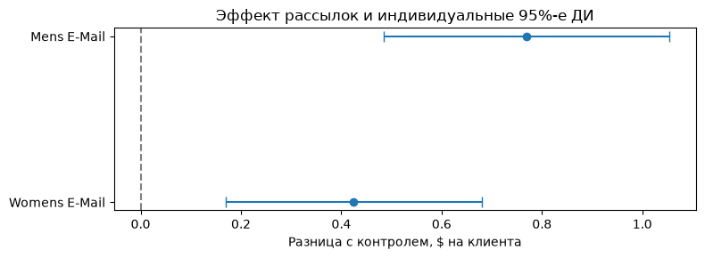

# A/B-тест email-рассылок в розничной торговле

Увеличивает ли рассылка расходы клиентов интернет-магазина? Проект оценивает эффект двух писем на данных эксперимента Hillstrom. **64 000 клиентов** случайно распределили между двумя вариантами письма и контролем без рассылки. Основная метрика — сумма покупок за две недели в среднем на клиента, включая клиентов без покупок.

## Результаты

Средняя сумма покупок в контроле составила **$0,65 на клиента**. Обе рассылки увеличили её относительно контроля.

| Вариант рассылки | Прирост на клиента | Индивидуальный 95%-й ДИ Уэлча | p-value по Холму |
|---|---:|---:|---:|
| Мужской ассортимент | **+$0,77** | $0,49–$1,05 | 2,33 × 10⁻⁷ |
| Женский ассортимент | **+$0,42** | $0,17–$0,68 | 0,00113 |



Оба сравнения статистически значимы после поправки Холма. Бутстрэп дал близкие интервалы. При условной марже 30% оценка порога окупаемости составляет **$0,23 и $0,13 на клиента** соответственно. Для решения о масштабировании эти пороги нужно сопоставить с фактической маржой и стоимостью кампании. Сравнение рассылок между собой потребовало бы отдельного теста.

## Ноутбуки

| Ноутбук | Содержание |
|---|---|
| [01 · Анализ данных](notebooks/01_data_quality_eda.ipynb) | Проверки качества, портрет клиентов и распределения расходов. |
| [02 · Проверка эксперимента](notebooks/02_experimental_validation.ipynb) | SRM для пропорции 1:1:1 и баланс характеристик до рассылки. |
| [03 · Оценка эффекта](notebooks/03_ab_analysis.ipynb) | Критерий Уэлча, поправка Холма, бутстрэп и сценарий окупаемости. |
| [04 · Планирование следующего теста](notebooks/04_power_aa_cuped.ipynb) | Выборка и MDE, A/A-симуляции и регрессионная поправка на историю покупок (CUPED). |

Для будущего теста с тремя равными группами MDE **$0,50** при мощности **80% на сравнение** требует около **72 000 клиентов** при принятых допущениях. В A/A-симуляции получено **4,60%** ложных срабатываний при пороге 5%. Поправка на прошлые расходы почти не изменила ширину доверительных интервалов.

Метрики, гипотезы и допущения описаны в [плане анализа](analysis_plan.md).

## Данные

Файл [data/hillstrom.csv](data/hillstrom.csv) входит в репозиторий. Каждая строка описывает клиента. В таблице есть история покупок до эксперимента, назначенная группа и результаты за две недели. Зафиксированы посещение сайта, факт покупки и сумма расходов. [Источник датасета Kevin Hillstrom](https://blog.minethatdata.com/2008/03/minethatdata-e-mail-analytics-and-data.html)

## Воспроизведение анализа

Понадобятся **Git** и **Python 3.11**. Ноутбуки можно открыть прямо на GitHub и запустить локально в браузере через JupyterLab.

Склонируйте репозиторий и перейдите в его корень.

```bash
git clone https://github.com/Artemtar05/retail-email-ab-testing.git
cd retail-email-ab-testing
```

**macOS и Linux**

```bash
python3.11 -m venv .venv
./.venv/bin/python -m pip install -r requirements.txt
./.venv/bin/python -m jupyterlab
```

**Windows (PowerShell)**

```powershell
py -3.11 -m venv .venv
.\.venv\Scripts\python.exe -m pip install -r requirements.txt
.\.venv\Scripts\python.exe -m jupyterlab
```

В открывшемся JupyterLab перейдите в `notebooks/`. Откройте ноутбуки 01–04 и в каждом выберите **Run → Run All Cells**. Каждый ноутбук самостоятельно читает CSV из `data/`.
